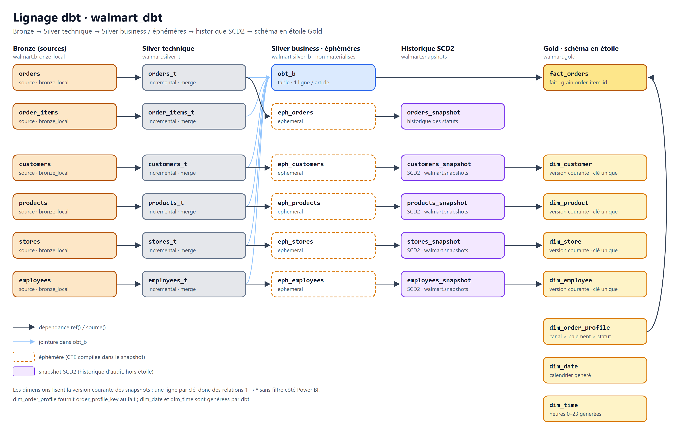
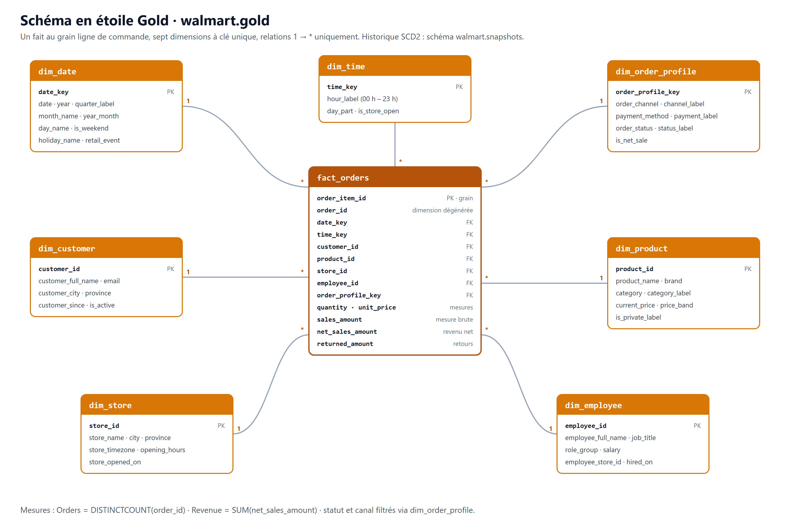

# Modèle de données et dbt



Projet : `airflow/walmart_dbt` (dbt Core 1.11, adaptateur `dbt-databricks`). Catalogue : `walmart`.

```text
walmart_dbt/
├── dbt_project.yml          matérialisations par dossier, réglages communs des snapshots
├── profiles.example.yml     modèle de profiles.yml (variables d'environnement)
├── macros/
│   ├── generate_schema_name.sql      écrit dans silver_t / silver_b / gold / snapshots sans préfixe
│   ├── drop_dbt_schema.sql           utilitaire : supprime l'ancien schéma walmart.dbt_schema
│   └── drop_legacy_gold_tables.sql   liste puis supprime (sur demande) les anciennes tables Gold
├── models/
│   ├── sources/sources.yml        bronze_local + fraîcheur
│   ├── silver_t/                  *_t.sql + silver_t.yml (tests)
│   ├── silver_b/                  obt_b.sql + obt_b.yml (tests)
│   └── gold/
│       ├── ephemeral/             eph_*.sql (projections lues par les snapshots)
│       ├── dim/                   7 dimensions du schéma en étoile + dims.yml
│       └── fact/                  fact_orders.sql + fact_orders.yml
├── snapshots/history_snapshots.yml  historique SCD2 (walmart.snapshots)
├── tests/
│   ├── generic/                   greater_than, valid_timestamp_order, line_amount_consistency
│   ├── assert_fact_order_totals.sql
│   ├── assert_order_employee_store.sql
│   ├── assert_order_handled_by_right_role.sql
│   └── assert_in_store_orders_within_opening_hours.sql
└── tools/restore_source_from_bronze.py
```

---

## Sources (`models/sources/sources.yml`)

Source `walmart_databricks`, schéma `{{ env_var('WALMART_BRONZE_SCHEMA', 'bronze_local') }}` : `orders`, `order_items`, `customers`, `products`, `stores`, `employees`.

`dbt source freshness` contrôle `orders.updated_timestamp` et lève un **avertissement** au-delà de 2 heures. Ce n'est pas une erreur : le générateur n'est pas toujours actif.

## Silver technique (`silver_t`)

Un modèle incrémental par table source (`incremental_strategy = merge`, `unique_key` = clé primaire). Chaque modèle copie la source (`source_data.*`) et ajoute `processed_at`.

| Modèle | Filtre incrémental |
|---|---|
| `orders_t`, `order_items_t` | `change_version > max(change_version) - var('cdc_overlap_versions')` (1 000) |
| `customers_t`, `products_t`, `stores_t`, `employees_t` | `updated_timestamp >= max(updated_timestamp) - var('cdc_overlap_minutes')` (10 min) |

Le filtre est factorisé dans la macro `incremental_cdc_filter`. La marge rattrape une ligne dont la transaction a été validée après une ligne plus récente (voir [ARCHITECTURE.md](ARCHITECTURE.md#2-ingestion-vers-databricks-ingest_cdc)) ; le `merge` sur `unique_key` rend la relecture sans effet.

## Silver business (`silver_b.obt_b`)

One Big Table au grain **ligne de commande** : `orders_t` joint `customers_t`, `order_items_t`, `products_t`, `employees_t` et `stores_t` (jointures `LEFT JOIN`). Les colonnes sont préfixées par entité (`customer_*`, `product_*`, `store_*`, etc.).

## Gold (`gold`) : schéma en étoile



Le Gold suit un schéma en étoile de Kimball :

- un fait au grain **ligne de commande** ;
- sept dimensions avec **une ligne par clé** ;
- uniquement des relations 1 → * ;
- aucun attribut descriptif dans le fait.

### Fait `fact_orders`

| Colonne | Rôle |
|---|---|
| `order_item_id` | Clé primaire, grain du fait |
| `order_id` | Dimension dégénérée (numéro de commande) |
| `date_key`, `time_key` | → `dim_date`, `dim_time` (heure locale du magasin) |
| `customer_id`, `product_id`, `store_id`, `employee_id` | → dimensions client, produit, magasin, employé |
| `order_profile_key` | → `dim_order_profile` (canal × paiement × statut) |
| `order_timestamp` | Horodatage local, conservé pour le détail |
| `quantity`, `unit_price` | Mesures de ligne |
| `sales_amount` | Montant brut de la ligne, tout statut |
| `net_sales_amount` | Montant si la commande est payée (`is_net_sale`), sinon 0 : base du revenu net |
| `returned_amount` | Montant si la commande est retournée, sinon 0 |

Une commande compte une fois : `DISTINCTCOUNT(order_id)`. Un changement de statut met à jour `order_profile_key` et les montants de la même commande, sans la dupliquer.

### Dimensions

| Dimension | Clé | Source | Attributs principaux |
|---|---|---|---|
| `dim_date` | `date_key` | Générée (2024 → fin de l'année suivante) | `date`, `year`, `quarter_label`, `month_name`, `year_month`, `day_name`, `is_weekend`, `holiday_name`, `retail_event` (Black Friday, semaine de Noël, Boxing Day) |
| `dim_time` | `time_key` (0–23) | Générée | `hour_label`, `day_part` (matin, midi, heure de pointe…), `is_store_open` |
| `dim_order_profile` | `order_profile_key` | Générée (5 paiements × 4 statuts) | `order_channel`, `payment_method`, `order_status`, libellés français, `is_net_sale` |
| `dim_customer` | `customer_id` | `customers_snapshot`, version courante | nom, e-mail, ville, province, `customer_since`, `customer_is_active` |
| `dim_product` | `product_id` | `products_snapshot`, version courante | nom, `category` / `category_label`, marque, `is_private_label`, `current_price`, `price_band` |
| `dim_store` | `store_id` | `stores_snapshot`, version courante | nom, ville, province, `store_timezone`, `opening_hours` |
| `dim_employee` | `employee_id` | `employees_snapshot`, version courante | nom, `job_title`, `role_group`, salaire, `employee_store_id`, `hired_on` |

Les dimensions client, produit, magasin et employé exposent aussi `*_version_id` (le `dbt_scd_id` de la version courante) et `version_valid_from`, pour relier une ligne à son historique.

### Historique SCD2 (`walmart.snapshots`)

Les snapshots dbt conservent l'historique complet, en dehors de l'étoile. Ils servent à l'audit et aux analyses d'évolution, par exemple les prix ou le cycle de vie d'une commande.

| Snapshot | Clé | `updated_at` | Lu depuis |
|---|---|---|---|
| `customers_snapshot` | `customer_id` | `customer_updated_timestamp` | `eph_customers` (`customers_t`) |
| `products_snapshot` | `product_id` | `product_updated_timestamp` | `eph_products` (`products_t`) |
| `stores_snapshot` | `store_id` | `store_updated_timestamp` | `eph_stores` (`stores_t`) |
| `employees_snapshot` | `employee_id` | `employee_updated_timestamp` | `eph_employees` (`employees_t`) |
| `orders_snapshot` | `order_id` | `order_updated_timestamp` | `eph_orders` (`orders_t`) : historique des statuts |

Réglages communs (`dbt_project.yml`) : `strategy: timestamp`, `dbt_valid_to_current: to_date('9999-12-31')`.

**Pourquoi le fait pointe vers la version courante et pas vers la version à la date de commande ?** La validité SCD2 (`dbt_valid_from`) est la date de **chargement** technique, pas une date métier. Les commandes historiques sont antérieures au premier chargement, et le réalignement de l'historique a été enregistré comme une nouvelle version. Une jointure à la date de commande rattacherait donc la plupart des lignes à des valeurs erronées ou à aucune. Le modèle retenu suit le pattern « dimensions courantes + historique SCD2 séparé ». Une analyse « à date » reste possible en joignant `fact_orders.order_timestamp` aux snapshots.

### Anciennes tables Gold

L'ancien modèle utilisait les snapshots comme dimensions directement dans `gold` (`dim_customers`, `dim_products`, `dim_stores`, `dim_employees`, `dim_orders`), avec deux sauvegardes manuelles. Ces 7 tables ont été supprimées le 16/10/2026 avec la macro `drop_legacy_gold_tables`. Le schéma `gold` ne contient plus que le schéma en étoile (`fact_orders` et les 7 dimensions). La macro reste disponible, en simulation par défaut :

```bash
dbt run-operation drop_legacy_gold_tables                       # liste seulement
dbt run-operation drop_legacy_gold_tables --args '{apply: true}'  # suppression
```

## Tests de qualité

Toute erreur de test arrête le DAG avant la publication suivante.

| Portée | Tests |
|---|---|
| Silver technique (6 modèles) | `not_null`, `unique` sur les clés, `greater_than: 0` sur identifiants et montants, `accepted_values: [Y, N]` sur `is_active`, `valid_timestamp_order` (updated ≥ created) |
| Relations Silver | `orders_t → customers_t / stores_t`, `order_items_t → orders_t / products_t`, `employees_t → stores_t` (avertissement pour la plupart, échecs stockés) |
| `order_items_t` | `line_amount_consistency` : \|line_amount − quantity × unit_price\| ≤ 0,01 |
| `orders_t` + `employees_t` | `assert_order_employee_store` : l'employé d'une commande appartient au magasin de la commande ; `assert_order_handled_by_right_role` (avertissement) : caissier en magasin, préparateur en ligne |
| `orders_t` | `accepted_values` sur `order_status` et `payment_method` ; `assert_in_store_orders_within_opening_hours` (avertissement) : ventes en magasin entre 7 h et 23 h, heure locale |
| `obt_b` | `order_item_id` non nul et unique ; `order_id`, `customer_id`, `product_id`, `store_name` non nuls |
| Dimensions Gold | clé `not_null` + `unique` pour chacune des 7 dimensions ; catégories autorisées dans `dim_product` |
| `fact_orders` | `order_item_id` unique ; chaque clé étrangère non nulle et présente dans sa dimension (`relationships` vers les 7 dimensions) ; `sales_amount > 0` ; `assert_fact_order_totals` (Σ lignes = `orders_t.total_amount`) |

---

## Commandes utiles

Depuis le conteneur worker (`docker compose exec airflow-worker bash`, puis `cd /opt/airflow/walmart_dbt`) :

```bash
dbt parse
dbt build --select silver_t
dbt snapshot
dbt run --select path:models/gold
dbt test --select path:models/gold
dbt source freshness
```

## Outils

| Outil | Rôle |
|---|---|
| `tools/restore_source_from_bronze.py` | Reconstruit la base source locale à partir de `walmart.bronze_local` (identifiants et `change_version` conservés). Mode simulation par défaut, `--apply` pour écrire. |
| `macros/drop_dbt_schema.sql` | `dbt run-operation drop_dbt_schema` supprime `walmart.dbt_schema`, l'ancien schéma créé avant la macro `generate_schema_name`. |
